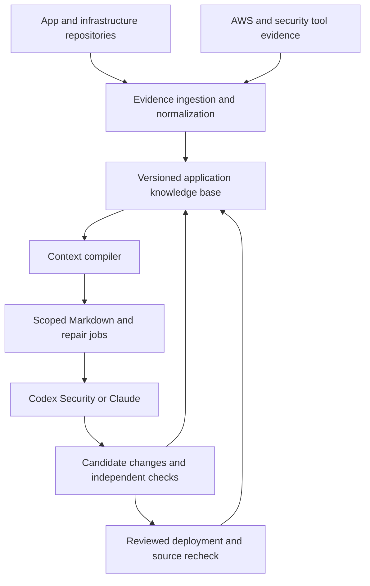
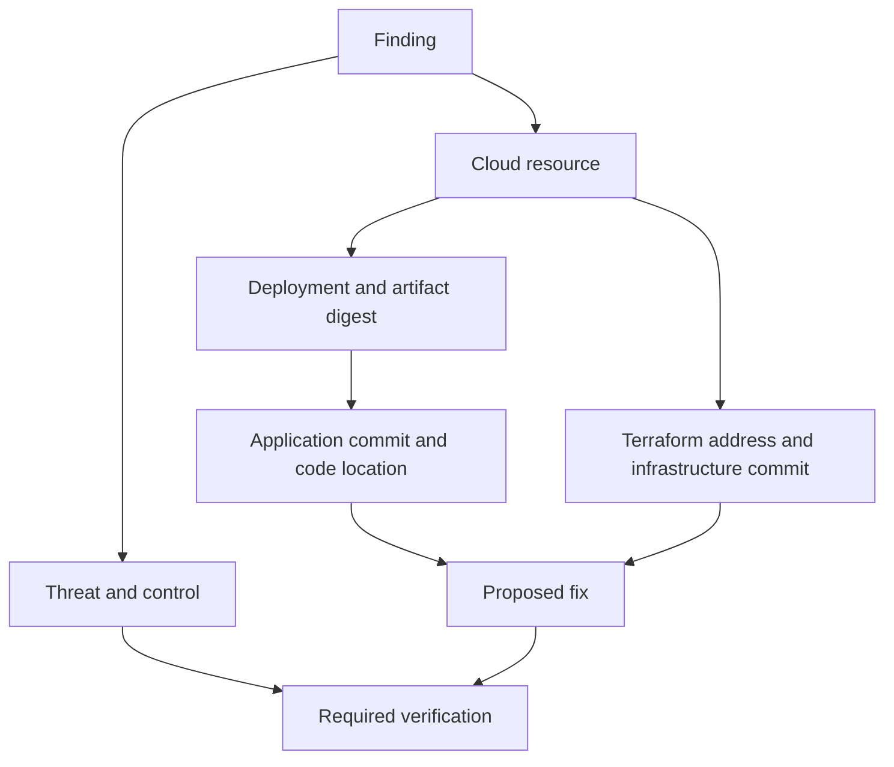

# Application and Cloud Security Context Platform

Research and design snapshot: 2 November 2026, Australia/Sydney.

For the expanded enterprise goal, start with [ENTERPRISE_APPSEC_BLUEPRINT.md](ENTERPRISE_APPSEC_BLUEPRINT.md). This document details its evidence and context layer; its pilot estimate applies only to that narrower scope.

## Decision

Build a context and verification layer around existing AWS, code analysis and remediation tools. Its central responsibility is to connect a security observation to the deployed asset, its application and infrastructure source, the relevant threat and control, and the evidence that a change actually fixed it.

Use AWS DevOps Agent for operational understanding; AWS Config and Security Hub for technical posture evidence; Graphify for code relationships; Threat Composer for portable threat models; and Codex Security as the initial scan/repair adapter. Preserve a model-independent knowledge base so a smaller model or deterministic repair recipe can replace individual tasks later.

This is a new reference architecture. No particular user application, AWS account, production architecture or previous product is assumed. The accompanying Python program implements a deliberately small offline context compiler. Cloud connectors, model execution, production authorization, deployment automation and a user interface remain implementation work.

## 1. The product boundary

The main product capability should answer six questions with evidence:

1. What application, version and environment does this finding affect?
2. Which deployed resource, package, function or endpoint is involved?
3. Which application or infrastructure repository owns the necessary change?
4. Which documented threat, business constraint and control apply?
5. What is the smallest defensible fix, and how will it be checked?
6. What evidence establishes the actual outcome after the change?

A scanner, a graph tool, an LLM and a document store each supply part of the answer. The linking and verification work is the product to implement. Avoid duplicating mature scanners and repair workflows before proving that linkage.

### System architecture

The loop stores unsuccessful attempts, missing evidence and rollbacks as well as verified outcomes. A successful agent response or merged pull request does not by itself establish remediation.

## 2. Component decisions

| Concern | Initial choice | Reason and boundary |
| --- | --- | --- |
| Application identity | Small service registry and deployment manifest | A durable app identifier joins repositories, resources and owners. |
| Cloud discovery | Existing inventory APIs plus AWS DevOps Agent exports | Preserve actual resource facts and learned topology separately. |
| Technical control posture | AWS Config Conformance Packs and Security Hub CSPM | Greenfield design cannot assume Audit Manager enrollment. |
| Code relationships | Graphify CLI, deterministic code extraction | Build a navigable graph without requiring language-model inference. |
| Security analysis | Existing SAST/SCA/IaC/DAST tools and Codex Security | Reuse native findings and documented scanner imports. |
| Threat model | Native Threat Composer JSON plus reviewed exports | Keep portable, editable source and machine-readable relationships. |
| Authoritative records | PostgreSQL and versioned object storage | Transactions, exact joins, provenance and lifecycle state. |
| Similarity retrieval | Optional pgvector beside full-text search | Retrieve relevant examples after access and identity filtering. |
| Workflow | Small durable job state machine; AWS Step Functions is one deployment option | Explicit retries, budgets, approvals, cancellation and outcome recording. |
| Remediation | Codex Security first; Claude or AWS Security Agent adapters later | A stable job/result contract avoids binding the knowledge base to one model. |
| Integration transport | Direct APIs, CLI jobs and signed webhooks | No dependency on MCP is necessary. |

Current product facts are documented in [AWS_POSTURE_AND_COMPLIANCE.md](AWS_POSTURE_AND_COMPLIANCE.md) and [INTEGRATIONS.md](INTEGRATIONS.md). These choices are engineering recommendations, not claims that all connectors have already been implemented.

### Material current-source changes

- AWS Audit Manager entered maintenance mode on 30 April 2026. Existing deployments have qualified continued access, but new enrollment is restricted. AWS Config does not replace a complete audit/GRC program. [AWS availability notice](https://docs.aws.amazon.com/audit-manager/latest/userguide/audit-manager-availability-change.html)
- AWS DevOps Agent documents topology exports and an Asset API for reviewed skills and agent guidance. Its topology export is documented as a web-app action; this design does not assume an unverified export API. [Topology](https://docs.aws.amazon.com/devopsagent/latest/userguide/about-aws-devops-agent-what-is-a-devops-agent-topology.html) · [Assets](https://docs.aws.amazon.com/devopsagent/latest/userguide/about-aws-devops-agent-managing-assets.html)
- Codex Security is a public CLI/SDK project with context inputs and external scanner import paths. [Repository](https://github.com/openai/codex-security) · [Imports](https://github.com/openai/codex-security/blob/main/docs/scanner-imports/README.md)
- Graphify's current code path can use local AST extraction with its language-model backend disabled. Graph edges still have coverage and inference limits. [README](https://github.com/Graphify-Labs/graphify) · [Architecture](https://docs.graphify.com/concepts/architecture)
- The MindsDB company now presents MindsHub as its broader product. Its original query engine remains available; evaluate that engine's maintenance and fit before adopting it as a foundational service. [Company explanation](https://mindshub.ai/mindshub-vs-mindsdb)

## 3. Keep three architectural views

### Observed architecture

Record resources, network paths, runtime identities, deployed artifacts, telemetry relationships and current configuration as observed at a specific time. Combine inventory data with DevOps Agent's topology. Label learned relationships and unresolved joins.

### Intended architecture

Record reviewed architecture decisions, intended trust boundaries, permitted data movement, required encryption, expected IAM permissions, resilience requirements and ownership. Generate proposals from the application's actual requirements and threat model; do not turn the existing deployment automatically into the desired standard.

### Deployed source provenance

Maintain a deployment manifest linking artifact digest to build, application commit, infrastructure commit, environment and resources. Terraform state or deployment metadata should establish the Terraform address-to-resource link. Resource tags are useful hints but are not sufficient proof of the executing source revision.

Compare these views to produce drift and unanswered questions. Examples include an observed public endpoint absent from the design, an IAM grant not represented in source, or a deployed image whose source revision cannot be established.

## 4. The identity graph is the difficult part

The source-code graph is one part of this application graph. A function call edge does not establish a runtime identity, an authorized IAM path, a deployed version or an exploitable attack chain.

### Minimum authoritative entities

| Entity | Key information |
| --- | --- |
| Application | Stable ID, tenant, service owner, data classification, business criticality. |
| Repository snapshot | Stable repository ID, URL, exact commit, language, worktree state. |
| Code entity | Repository snapshot, path, symbol, range, extraction method and version. |
| Artifact | Immutable digest, build ID, package/SBOM references, source provenance. |
| Deployment | Environment, deployed artifact, app/infra revisions, change ID, time. |
| Resource | Account, Region, ARN/resource ID, resource type, configuration version. |
| Relationship | Typed endpoints, evidence reference, confidence, validity interval. |
| Finding | Native source ID, scanner/rule/CVE/CWE, location, severity and assessment state. |
| Threat | Native model/threat ID, assets, boundaries, assumptions and mitigations. |
| Control | Versioned requirement, scope, evidence obligations and technical/manual checks. |
| Fix attempt | Base revision, candidate patch, agent/runtime, tests, review and rollout outcome. |
| Lesson | Preconditions, successful and failed outcomes, limitations and expiry. |

Scope every entity and relationship by tenant and application. Retain environment where it affects meaning. Source records keep collection time, source run/version, source record ID, evidence hash and classification. Maintain actual timestamps separately from the time a document was generated.

### Relationship confidence

Use explicit labels such as observed, statically resolved, model suggested, and reviewer approved. Preserve why each relationship exists. A model-suggested ownership mapping should enter a review queue rather than silently authorizing a patch.

When multiple repositories claim the same resource or no deployment manifest identifies the running commit, produce an unresolved mapping. The first implementation should stop automated routing for that finding until the mapping is supplied.

## 5. Evidence ingestion and context compilation

Separate adapters from the compiler. An adapter converts a documented native format into the canonical contract and stores the original evidence. The compiler validates identifiers, schema versions, scope, timestamp freshness and source revisions; selects the relevant subset; and renders deterministic views.

The accompanying prototype starts at the canonical bundle boundary. It does not claim native SARIF, ASFF, OCSF, Threat Composer or Graphify parsing. Production adapters can be added independently without changing the core principle.

### Connector contract

Each connector needs its own version, authentication scope, pagination/checkpoint behavior, retry policy, deletion/tombstone handling, source coverage statement and health state. An empty result from a failed collector is not a clean security assessment.

Use source-native event IDs and object versions for idempotency. Link duplicate observations while retaining each source's assessment and provenance. Do not merge unrelated findings solely because they share a CVE or a similar title.

### Context selection order

1. Enforce tenant, application, repository and environment access.
2. Resolve exact finding, package, resource and deployment identifiers.
3. Add a bounded set of code and architecture relationships with provenance.
4. Add relevant threat assumptions, control requirements and approved constraints.
5. Retrieve prior fix examples by exact preconditions, then lexical/vector similarity.
6. Render a compact task packet with source links, open questions and required checks.

Keep raw SIEM/XDR log data, credentials, customer payloads and sensitive scanner exports in restricted storage. Include redacted excerpts or evidence references only when needed for the task.

### Refresh triggers

| Trigger | Invalidated context |
| --- | --- |
| Application commit | Affected source graph, code findings, tests and repair candidates. |
| Infrastructure commit or apply | Resource ownership/configuration, drift and relevant controls. |
| Deployment | Deployed source/artifact links and runtime finding applicability. |
| New scanner or cloud finding | Affected finding, priority, context packet and related lessons. |
| Threat model or architecture decision | Relevant assumptions, mitigation requirements and checks. |
| Access revocation or data retention expiry | Retrieval eligibility, cached views and exported context. |
| Verification result or rollback | Fix outcome and eligibility for future reuse. |

Debounce changes and publish generated documentation through a reviewable update. Regenerate only affected views where possible; avoid a commit storm from every runtime event.

## 6. Repository delivery

Maintain a small reviewed instruction layer and a separate generated evidence layer. Existing AGENTS.md, CLAUDE.md and SECURITY.md content must be preserved. They can point to project guidance and evidence, but external scanner descriptions must not become trusted instructions.

Recommended projections include architecture, cloud posture, threat model, control evidence, ownership mappings and task-specific repair context. A shared context manifest identifies the exact input snapshot used by both repositories. [REPO_CONTEXT_CONTRACT.md](REPO_CONTEXT_CONTRACT.md) defines the layout and review rules.

Codex Security accepts architecture and security documents directly through its knowledge-base option. Use that supported boundary instead of relying on every Markdown file being loaded automatically. [Official CLI reference](https://learn.chatgpt.com/docs/security/cli/reference)

## 7. Remediation and verification

Define a job with exact repositories/base SHAs, allowed files, relevant finding IDs, context manifest, requested outcome, permitted tools and resource/time budget. The worker produces a candidate patch plus a structured explanation and uncertainty. The orchestration service owns permissions and workflow state.

Use independent checks appropriate to the change: compiler/type checks; unit/integration tests; security regression tests demonstrating the original bug; originating scanner rechecks; dependency/lockfile checks; Terraform validation/plan; and a staging or post-deployment configuration/runtime check. These checks are selected by the repository's actual build and deployment process.

Keep these outcomes distinct: proposed, source-assessed, test-verified, reviewed, merged, deployed, runtime-verified, reopened and rolled-back. Codex Security's validation and fix assessment are useful evidence; they do not establish that independent tests and runtime checks ran. [CLI behavior](https://learn.chatgpt.com/docs/security/cli/reference)

For a change spanning app and infrastructure repositories, create linked candidate changes under one job ID. Define rollout order and compatibility before approval. Updating an IAM policy and the caller code independently can otherwise break an application even when each repository's tests pass.

## 8. A concrete example

Consider a hypothetical document-upload service. A cloud control reports a public storage policy. SAST identifies an unsafe redirect path. A SIEM event records unusual access to the same service. These signals may be related, but the system must establish that relationship rather than asserting it from similar text.

The resolver first joins the bucket ARN to its Terraform address and deployment, and the service deployment to an immutable application image digest and source commit. It attaches the threat-model assumption that uploaded documents are private. It then creates separate but linked remediation tasks for the bucket policy and the application path, each with its own evidence and tests.

After review, a rollout changes the infrastructure and deploys the new application artifact. A fresh control evaluation and application regression test determine the recorded outcomes. The lesson preserves the exact framework and module versions, preconditions and negative tests so it can be reused only where applicable.

This example is illustrative. No actual vulnerability or user cloud resource was inspected in this work.

## 9. Build sequence and exit criteria

| Stage | Deliverable | Evidence that the stage is complete |
| --- | --- | --- |
| Reference slice | Offline canonical bundle, Markdown compiler and searchable ledger | Scope, freshness, ownership and input-validation tests pass. |
| One real application | Two repository snapshots, deployment manifest, one cloud and one code source | A resource maps to the correct source without guessed ownership. |
| Threat/control context | Reviewed Threat Composer model and technical evidence mapping | Every asserted status links to scoped, dated evidence. |
| First real remediation | A candidate patch and independent verification | Original failure reproduced safely, correction tested, reviewer accepts. |
| Runtime closure | Deployment and source-system recheck | Outcome reflects deployed behavior, including failed or rolled-back attempts. |
| Connector expansion | Additional SCA/CNAPP/XDR/SIEM adapters | Contract tests, source coverage, deduplication and access boundaries are demonstrated. |
| Smaller-model evaluation | Task-specific baseline and held-out evaluation | Measured cost per verified fix improves without unacceptable regressions. |

Planning estimate, not a delivery commitment: one experienced engineer with available access could target a focused internal pilot in roughly 4–8 weeks. Multi-tenant authorization, high-quality connectors, enterprise integrations and reliable production repair form a larger multi-month product effort. Scope, codebase complexity and access preparation dominate the estimate.

## 10. Inputs needed for a live pilot

Provide the application repository and infrastructure repository, their target branches, the app's language/framework and deployment platform, AWS account/Region/environment scope, an existing deployment manifest or equivalent provenance, and the first available code/cloud scanner exports. State which framework/control set matters and which files or resources the repair worker may modify.

For an initial Sydney deployment, verify feature availability per service and feature. DevOps Agent's Sydney availability does not imply that all release testing previews are available there. [Current region table](https://docs.aws.amazon.com/devopsagent/latest/userguide/about-aws-devops-agent-supported-regions.html)

## Related deliverables

- [AWS posture and compliance](AWS_POSTURE_AND_COMPLIANCE.md)
- [Threat Composer, scanner and repair integrations](INTEGRATIONS.md)
- [Repository context contract](REPO_CONTEXT_CONTRACT.md)
- [AppSec workflow specifications](APPSEC_SKILLS.md)
- [Knowledge base and smaller-model strategy](KNOWLEDGE_AND_SMALL_MODELS.md)
- [Prototype usage and verified implementation status](README.md)
