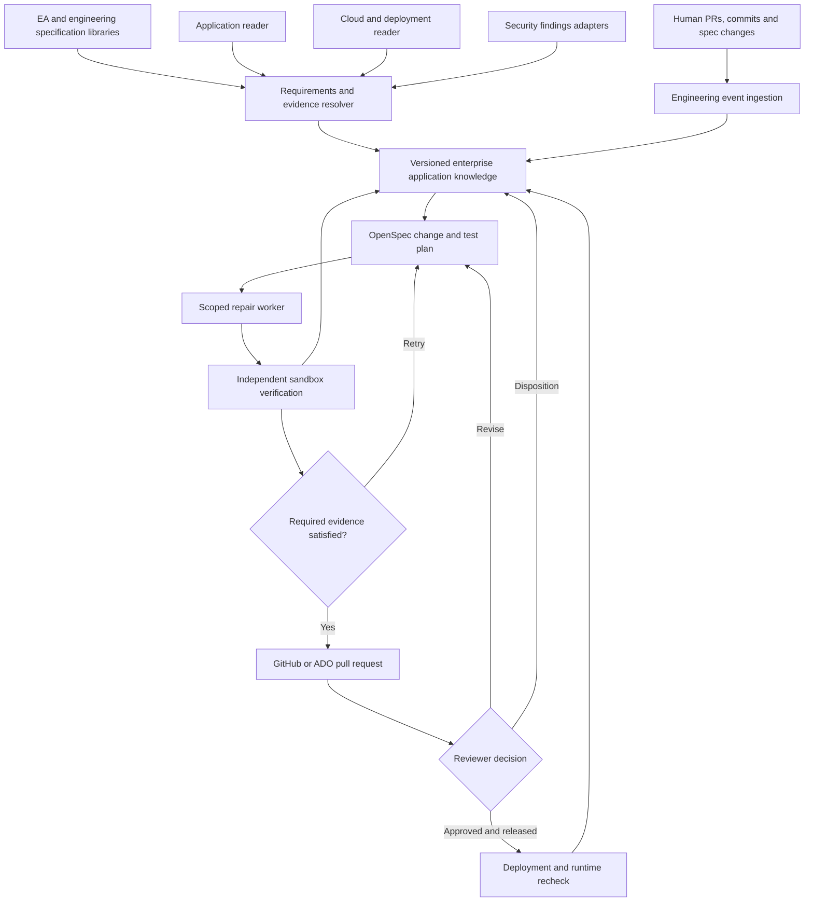
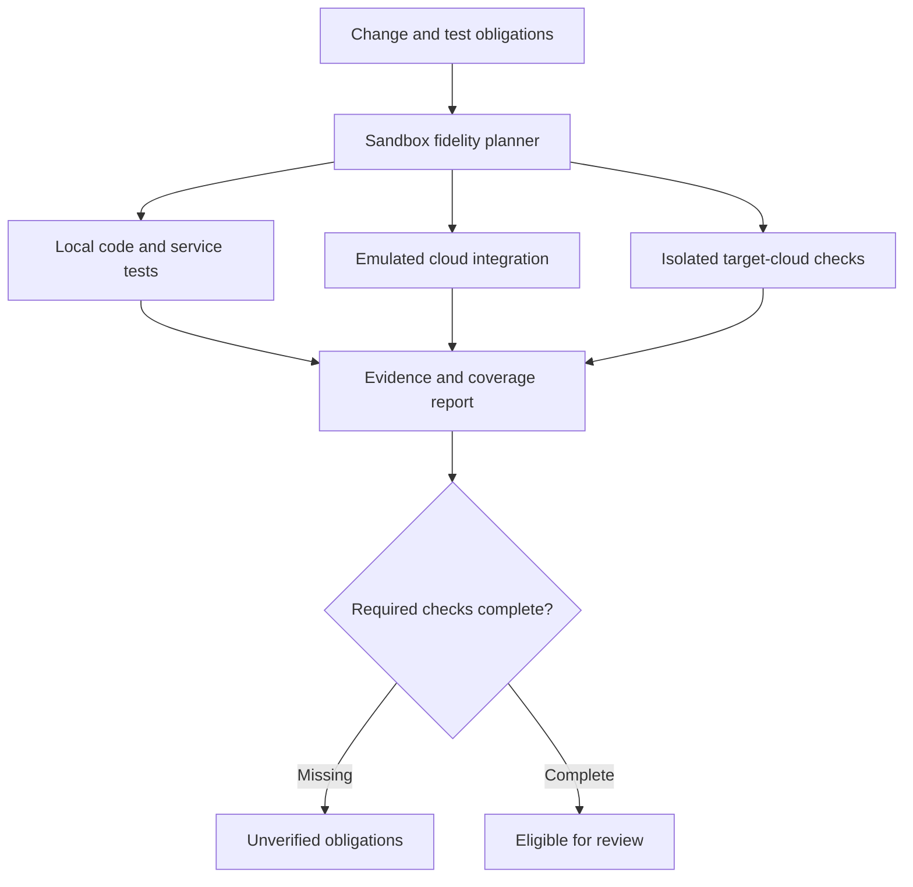

# Enterprise AppSec Engineering Agent

## Goal and design decision

Build an enterprise AppSec engineering platform whose normal output is a verified, review-ready pull request. It understands the organisation's architecture standards, reconstructs how each application actually works, correlates security evidence across code and cloud, creates OpenSpec changes, implements fixes, generates and runs meaningful tests, and retains the engineering experience. Developers review changes and clarify intent; they are not the routine implementation workforce for security remediation.

The durable asset is the organisation's governed knowledge of requirements, architecture, failure modes, fixes, test evidence and outcomes. Coding models are replaceable workers within that system. A decade of useful learning means maintaining and revalidating this knowledge as applications, policies and cloud services change; it does not mean accumulating old Markdown or trusting an increasingly large model memory.

Design snapshot: 2 November 2026, revised for the enterprise automation and review product contract. This document supersedes the narrower framing in ARCHITECTURE_BLUEPRINT.md; that document remains useful implementation detail for the evidence/compiler layer. No user application or cloud account has been assessed. The delivered executable is an offline context/compiler foundation, not the complete enterprise agent. The operating model below is the product to build.

## 0. Product contract and onboarding

**Connect the company's engineering systems, environments, security tools and standards. Receive security fixes as pull requests with readable specifications and independently produced evidence. Review the result. The platform retains the context and outcome of both automated and human changes.**

The normal developer actions are approve, request a revision, or record a decision. An unsuccessful repair remains a platform-owned case: the platform diagnoses, retries within its budget, obtains a focused requirement decision, or identifies a missing integration. Routine failure must not become a ticket asking a developer to write the patch.

This is a product for multiple clouds and architectures through tested support profiles. A profile declares supported languages/frameworks, build systems, deployment patterns, cloud services, vulnerability classes and verification capabilities. A connector being reachable does not establish that every application behind it is understood or testable. Every application receives a coverage report with supported, inaccessible, unsupported and unverified components. The onboarding experience stays consistent as coverage expands.

### Five-step administrator setup

| Step | Administrator supplies | Platform completes |
| --- | --- | --- |
| 1. Connect engineering systems | Approved GitHub organisations or Azure DevOps projects, CI connections and scanner accounts | Discovers repositories, owners, builds, findings and event subscriptions; verifies connector permissions and coverage. |
| 2. Connect environments | Approved cloud accounts/subscriptions/projects, deployment inventory and read access | Reconstructs deployed resources and dependencies; connects artifacts to source revisions; proposes application ownership mappings. |
| 3. Adopt company rules | EA, AppSec, domain and tech-lead specification packs, with approved exceptions | Resolves versions and applicable requirements; identifies conflicts and missing business intent. |
| 4. Choose execution policy | Allowed model profiles, data classifications, sandbox profiles, repair scope and budgets | Verifies model capabilities and data routes; validates isolated execution, test dependencies and required cloud checks. |
| 5. Activate PR delivery | Selected applications, repository targets, reviewers and existing merge rules | Runs calibration, reports actual coverage and enables continuous remediation with evidence-linked PRs. |

These are five guided setup stages, not a claim that enterprise integration always takes five clicks. Subsequent application activation should usually be select application, confirm discovered ownership and critical flows, then activate. Application teams should not repeatedly recreate the platform's cloud/scanner/model plumbing.

### Ownership of the work

| Work | Accountable party |
| --- | --- |
| Investigate findings; draft specifications; implement patches; create tests; provision sandboxes; rerun failed attempts; publish PRs | AppSec platform and its automation. |
| Review the proposed engineering change; explain ambiguous application intent | Application reviewer or owner. |
| Publish mandatory standards and approve changes to them | EA, AppSec and designated technical/domain leads. |
| Accept a known risk or approve an exception | The organisation's authorised risk/requirement owner. |
| Add unsupported connectors, execution profiles or framework support; resolve platform failures | Platform engineering and AppSec operations. |

A developer can still choose to edit code or a spec directly. The ingestion and learning path must handle that change just as carefully as an agent-authored patch. Manual implementation is supported; it is not the prerequisite for completing the normal repair workflow.

### Definition of an automatic repair outcome

A case reaches **ready for review** only when the candidate is bound to exact revisions, the required pre-merge checks have completed successfully, the approved behavioural contract is preserved to the declared verification coverage, and the evidence is current. A draft PR may expose partial progress, but it must not carry a ready status while required evidence is missing.

Before merge, the system can establish a candidate's sandbox and control-check results. It cannot already prove a future production deployment. After deployment, it rechecks the running artifact, closes or reopens the finding based on evidence, and records the actual outcome. Review approval, merge, deployment and verified closure are separate events.

## 1. End-to-end system

Each box is a responsibility with explicit inputs and outputs. It need not be an autonomous LLM. Parsing, identity resolution, source-version checks, permission decisions, job scheduling, evidence handling and most rendering should be ordinary deterministic software.

### Responsibility map

| Component | Reads | Produces |
| --- | --- | --- |
| Standards resolver | EA patterns, security requirements, tech-lead stack packs, approved exceptions | Effective versioned requirements and their verification obligations. |
| Application reader | Source, manifests, APIs, schemas, dependencies, tests and sanitized traces | Code relationships, functional contracts, inferred architecture and unknowns. |
| Cloud reader | IaC, deployment manifests, cloud inventory, DevOps Agent topology and telemetry | Observed resources, identities, network relationships and source provenance. |
| Security adapters | SAST, SCA, DAST, secrets, IaC, CNAPP and approved XDR/SIEM evidence | Source-attributed observations linked to code, packages, endpoints and resources. |
| Context resolver | Requirements plus the three evidence streams | A bounded, reproducible context packet for a particular change. |
| OpenSpec planner | Context, intended behaviour and effective standards | Proposal, design, changed requirements, implementation tasks and acceptance scenarios. |
| Repair worker | Approved scope, plan, source snapshots and relevant prior cases | App/IaC patch candidates and candidate tests. |
| Verification service | Candidate artifacts, protected tests, requirements and sandbox profile | Independently produced results with a fidelity and coverage statement. |
| Repository publisher | Candidate changes, trusted verification results and repository policy | A GitHub/ADO PR, concise summary, current-revision checks and reviewer routing. |
| Decision processor | Native reviews, spec edits and structured dispositions | Approved decisions, revised jobs, risk/intent requests and preserved feedback. |
| Engineering-event ingestor | Human and agent PRs, commits, CI, deployment, rollback and scanner events | Deduplicated events and reconciled, authoritative change snapshots. |
| Experience curator | Patch, review, tests, deployment and follow-up observations | A governed fix case and possible reusable recipe or proposed standard improvement. |

The orchestration service, IAM and runner enforce permissions. Instructions in Markdown explain the work but do not enforce these boundaries.

Before transmitting a context packet, the dispatcher checks the approved inference provider, endpoint, Region, retention arrangement and data classification. Repository read access does not itself authorize sending code or incident evidence to every model provider. Disallowed context stays within its approved environment and is routed to an eligible local worker or held for resolution.

### Control service and customer execution environment

The control service owns application registration, support profiles, policy resolution, durable cases, scheduling, budgets, connector health and review delivery. An enterprise deployment can place the whole system in the customer's environment, or use a managed control service with customer-operated collectors and runners, subject to an explicit data contract. Model placement is an independent choice: customer-operated inference does not by itself make every other component local.

Collectors receive read access appropriate to their sources. Patch workers receive scoped temporary workspaces and approved tools. Verification workers obtain separate credentials and protected test assets. The publisher receives the limited repository permission needed to update branches, PRs and checks. No model acquires all those authorities merely because it has retrieved the architecture documents.

## 2. Enterprise specifications as reusable libraries

Treat architecture and engineering standards as versioned dependencies. An application adopts specific versions of general guidance, mandatory enterprise requirements, platform patterns and language/framework rules. EA and tech leads remain accountable for publishing and changing those requirements.

Examples of proposed packs:

| Pack | Owner | Example content |
| --- | --- | --- |
| Enterprise identity and authorization | Security architecture | Trusted identity claims, tenant isolation, service authorization and audit events. |
| AWS private workload pattern | Cloud architecture | Ingress/egress intent, approved identity boundaries, encryption and observability. |
| Java/Spring application engineering | Java platform leads | Approved libraries, integration conventions and test harnesses. |
| Python/API application engineering | Python/API leads | Request validation, authorization hooks, errors and dependency policy. |
| CI/CD and software supply chain | DevSecOps platform | Build provenance, permitted runner trust, signing and release gates. |
| Claims or payments business domain | Domain engineering | Functional invariants, data classifications and critical user journeys. |

A useful pack contains requirement IDs, normative text, applicability predicates, approved and prohibited patterns, examples, compatibility bounds, verification obligations, owner, version, expiry/deprecation policy and references. Executable checks and sandbox definitions are separate signed assets with their own permissions. Downloading a spec must not automatically execute code from its publisher.

### OpenSpec's existing contribution

OpenSpec provides reviewable specifications and change artifacts. Its current beta Stores support shared planning repositories, and references can expose centrally owned requirements to consumers. Worksets make the shared store and participating source repositories available in an editor workspace. These are useful building blocks. [OpenSpec](https://github.com/Fission-AI/OpenSpec) · [Stores](https://openspec.dev/docs/stores) · [Worksets](https://openspec.dev/docs/worksets)

The enterprise system still needs a controlled acquisition and adoption process: trusted publisher identity, exact commit/digest pinning, dependency resolution, compatibility checks, change impact analysis and exception handling. OpenSpec does not itself download and synchronize Git repositories. A store reference must not be mistaken for a signed, immutable enterprise lock. [Store user guide](https://github.com/Fission-AI/OpenSpec/blob/main/docs/stores-beta/user-guide.md)

### Requirement precedence and exceptions

Resolve requirements by declared authority and applicability, not by whichever document is loaded last. Mandatory enterprise requirements remain applicable when a stack pack or application spec changes. App-specific additions may strengthen them. A conflict creates a decision request with both sources; the model must not silently choose the easier one.

An exception is a first-class record: requirement ID and version, affected app/environment, compensating controls, accountable approver, rationale, expiry and required review. An agent cannot waive the standard simply by generating a new local specification.

## 3. Reverse engineer the application without losing intended behaviour

Application understanding needs several kinds of evidence. Graphify is a useful structural index, but the system also needs APIs, data models, configuration, framework conventions, existing tests and observed runtime paths. Current Graphify documents deterministic code extraction and explicitly describes coverage limitations. [Graphify](https://github.com/Graphify-Labs/graphify) · [Graph architecture](https://docs.graphify.com/concepts/architecture)

### Produce four separate outputs

1. **Observed implementation model:** source and runtime facts, including imperfections.
2. **Inferred functional model:** hypothesized user journeys, state transitions and invariants, each with evidence and uncertainty.
3. **Approved intended contract:** reviewed application behaviour plus adopted enterprise requirements.
4. **Gap model:** differences among implementation, deployment and intended contract.

Existing tests are evidence of expectations, not absolute authority. A characterization test can preserve a bug. When observation conflicts with an approved requirement, retain the disagreement and determine the intended behaviour before treating the test as a gate.

### Build the missing business model

For each important flow, identify actor, entry point, trust boundary, authorization decision, data access, side effects, external integrations, asynchronous work, failure behaviour and audit events. Document which parts were confirmed by tests or traces and which were inferred from code.

Some intent cannot be reliably reverse engineered: why a payment limit exists, whether an administrator may cross a tenant boundary, or whether a retention policy applies to a legacy exception. Ask the owner targeted questions about those gaps, and preserve the answers as reviewed decisions.

## 4. Reverse engineer cloud architecture and bind it to source

Collect the deployed architecture independently from the source repository. Establish a chain from repository commit to build artifact, immutable image/package digest, deployment and cloud resources. Map Terraform/CloudFormation resources to the actual resource identifiers.

Define provider-neutral adapters for resource discovery, deployment provenance, identity/network relationships, control evidence, sandbox provisioning and runtime verification. AWS is an initial implementation profile. Azure, GCP, Kubernetes and on-premises profiles implement the same contracts with provider-specific evidence and test semantics. An Azure workload needs the applicable Azure evidence; it does not need an irrelevant AWS compliance badge.

| Profile | Example source categories | Product responsibility |
| --- | --- | --- |
| AWS | Inventory and deployment records, Config, Security Hub CSPM, DevOps Agent, available Audit Manager evidence | Join resources to code, preserve rule/control provenance, and select AWS fidelity requirements. |
| Azure | Resource Graph, Defender for Cloud, deployment records and policy evidence | Normalize resource/assessment identities and select Azure verification obligations. |
| GCP | Cloud resource/deployment inventory and Security Command Center findings/exports | Normalize project/resource identities and select GCP verification obligations. |
| Kubernetes/on-premises | Cluster/workload inventory, platform APIs, approved network/identity evidence and deployment records | Declare what the connector observes and what requires an integration-specific test. |

Microsoft documents security assessment queries through Resource Graph; Google documents Security Command Center findings exports including continuous exports. These are collection inputs, not complete reverse-engineering systems. [Azure queries](https://learn.microsoft.com/en-us/azure/defender-for-cloud/resource-graph-samples) · [GCP exports](https://docs.cloud.google.com/security-command-center/docs/how-to-export-data)

Cloud posture collection, control evaluation and audit evidence are separate operations. AWS Config evaluates resource configuration against rules. Audit Manager collects and organizes evidence; AWS explicitly states that it does not itself assess compliance. The PR reports named applicable checks and coverage, rather than asserting that the entire company is compliant. [Config rules](https://docs.aws.amazon.com/config/latest/developerguide/evaluate-config.html) · [Audit Manager](https://docs.aws.amazon.com/audit-manager/latest/userguide/what-is.html)

AWS DevOps Agent contributes discovered topology and operational context. Its JSON/Mermaid exports and investigation-summary integration are useful inputs, but the system should also retain direct inventory and configuration evidence. [Topology](https://docs.aws.amazon.com/devopsagent/latest/userguide/about-aws-devops-agent-what-is-a-devops-agent-topology.html) · [Event integration](https://docs.aws.amazon.com/devopsagent/latest/userguide/configuring-integrations-and-knowledge-integrating-devops-agent-into-event-driven-applications-using-amazon-eventbridge-index.html)

Keep observed architecture, IaC intent and EA-approved architecture separate. A resource discovered in production is not automatically permitted. A Terraform declaration is not proof that it was applied. An application commit on the default branch is not proof that the matching binary is deployed.

## 5. Join security observations rather than combining their text

An adapter retains the scanner's native record, original severity, rule identifier and source evidence. It links to an appropriate identity:

| Input | Strong initial join |
| --- | --- |
| SAST | Repository revision, path/symbol, rule and code flow. |
| SCA | Package identity/version, dependency path, artifact digest and deployed presence. |
| DAST | Assessed URL/API operation, environment, authenticated role and reproduction evidence. |
| IaC scanner | Repository revision, module/address and plan/state reference. |
| CNAPP | Cloud resource, account/Region, identity/exposure relationship and observation time. |
| XDR | Workload/host/container identity and bounded incident timeline. |
| SIEM | Correlated event/incident IDs, affected assets and confidence/coverage. |

Use CVE/CWE/rule equivalence and exact identity to relate observations. Preserve disagreement. Do not interpret a SIEM alert as a code vulnerability or a graph path as a successful exploit without further evidence.

An example context packet should explain: this authorization flaw is in this API, the deployed service uses this identity and data store, these enterprise requirements apply, these existing flows must continue, and these tests will show whether the change works.

## 6. OpenSpec as the change contract

For a specific remediation, the planner creates a proposal explaining risk and intended result; a design connecting the app/cloud change to the adopted architecture; requirement deltas and acceptance scenarios; and tasks covering implementation, tests, evidence and rollout.

The planner should include a requirement-to-test matrix. Every material requirement maps to a check, a known manual review or a clearly stated verification gap. Structural spec validation and advisory code review are separate from actual execution evidence. See [OPENSPEC_AND_ENTERPRISE_STANDARDS.md](OPENSPEC_AND_ENTERPRISE_STANDARDS.md).

A repair job contains the exact app/infra base SHAs, adopted spec lock, sandbox profile, findings, approved scope, forbidden changes, model/runtime configuration and budget. It produces linked repository changes under one change ID. The orchestrator owns cross-repository rollout ordering; the existence of a shared plan does not create a transaction across repositories.

### Keep the review surface small

The first screen answers five questions: what was wrong, what changed, what legitimate behaviour still works, what was verified, and what decision is needed. Show a short spec and link to the diff, detailed evidence and rollback information. Raw scanner dumps, topology exports and full build logs belong behind the evidence link.

The readable spec begins with **what must change**, **what must keep working**, and **what proves the result**. The reviewer should not have to interpret the complete underlying OpenSpec artifact set to understand a repair.

| Primary action | Behaviour |
| --- | --- |
| Approve change | Record the native review and follow existing merge/deployment rules. Continue observing later outcomes. |
| Request revision | Accept a plain-language comment or spec edit; check authority, version the intended change, regenerate affected code/tests and rerun invalidated verification. |
| Record a decision | Capture a typed disposition and route any required approval, while preserving the finding and patch history. |

Decision types include reject this implementation, false positive, accepted risk, defer, duplicate, out of scope and requirement correction. Rejecting an implementation keeps the vulnerability open. A false-positive disposition requires supporting evidence. Accepting a known risk requires the authorised owner, scope, rationale and expiry. A local spec edit cannot silently waive an enterprise requirement.

### Reliable continuous PR delivery

Persist cases and events before processing them. Deduplicate source deliveries, handle delayed/out-of-order events, and periodically reconcile repository, CI, deployment and scanner state. Resume or cancel jobs after worker loss without forgetting their evidence or creating duplicate PRs. Related repairs need concurrency control; incompatible changes must be combined, ordered or replanned.

Bind every published result to the evaluated app/infra revisions, applicable base/merge candidate, spec lock, environment profile and tool versions. A new PR head or relevant target-branch change invalidates affected evidence. The platform rebases, resolves conflicts within policy and reruns the necessary checks before publishing a fresh success status. Group coherent repairs into manageable PRs; do not create a new PR for every repeated scanner event.

GitHub Check Runs are associated with a head SHA. Use a dedicated GitHub App and appropriate installation credentials for the product's checks and automatic PR workflow execution. Current GitHub documentation notes that some PR events created with GITHUB_TOKEN enter an approval-required workflow state. Azure DevOps supports statuses on specific PR iterations. Its service-hook event named git.pullrequest.merged describes a merge attempt, so the adapter must refetch authoritative status before treating it as completion. [GitHub checks](https://docs.github.com/en/rest/checks/runs?apiVersion=2022-11-28) · [Workflow triggering](https://docs.github.com/en/actions/how-tos/write-workflows/choose-when-workflows-run/trigger-a-workflow) · [ADO statuses](https://learn.microsoft.com/en-us/azure/devops/repos/git/pull-request-status?view=azure-devops) · [ADO events](https://learn.microsoft.com/en-us/azure/devops/service-hooks/events?view=azure-devops)

Webhook delivery alone cannot establish that every change was captured. GitHub retains a delivery identifier on redelivery; Azure DevOps documents retry/probation behaviour that can lose new events. Authenticated event ingestion, idempotency, checkpoints and reconciliation/backfill are all part of the product contract. [GitHub webhook practices](https://docs.github.com/en/webhooks/using-webhooks/best-practices-for-using-webhooks) · [ADO troubleshooting](https://learn.microsoft.com/en-us/azure/devops/service-hooks/troubleshoot?view=azure-devops)

When repair cannot proceed, the case has an explicit reason and owner: unresolved intent goes to the application owner as a focused question; unsupported execution or integration goes to platform engineering; risk acceptance goes to the authorised risk owner. Bounded retry exhaustion stays in the platform/AppSec operations queue with its attempted fixes and evidence. These routes do not turn the normal developer review experience into manual remediation work.

## 7. Functional tests are central to security remediation

For an authorization flaw, proving that an attacker receives a denial is only half the work. The legitimate user must still complete the original business flow. The system should preserve intended behaviour while closing the identified security gap.

Use a test set with distinct purposes:

- Unit checks for the changed logic and boundary conditions.
- Security regression checks that fail on the original vulnerable revision and pass on the candidate.
- Integration checks against real disposable databases, queues and other relevant dependencies.
- Contract checks for downstream APIs and events.
- Functional end-to-end journeys, including successful and denied operations.
- Applicable IaC, dependency and cloud identity/configuration checks.
- A bounded re-run of the originating finding or equivalent independently defined detector.

The repair worker may propose tests, but a verifier must protect the acceptance criteria and existing tests from being weakened. Different prompts or a second model alone do not provide independence. The trusted runner, versioned tests, assertions and recorded execution evidence are the foundation.

## 8. A local sandbox with a declared fidelity contract

Construct the smallest disposable environment that faithfully exercises the affected flow. Use containerized application services and real test dependencies where practical; emulate supported cloud APIs; retain explicit gaps for semantics that require real cloud execution.

The local environment is a model of a selected application flow, not a claim to reproduce the enterprise cloud completely. Testcontainers supplies disposable dependencies; Terraform mocks can check configuration logic; LocalStack can cover supported AWS interactions. Each has a different evidential role. [Testcontainers](https://testcontainers.com/) · [Terraform provider mocking](https://developer.hashicorp.com/terraform/language/tests/mocking)

For IAM-dependent tests, verify emulator configuration and service coverage. LocalStack documents IAM enforcement as disabled by default and subject to plan/service support. A green test without enforcement is not evidence that AWS would deny the request. [IAM enforcement](https://docs.localstack.cloud/aws/developer-tools/security-testing/iam-policy-enforcement/) · [IAM coverage](https://docs.localstack.cloud/aws/developer-tools/security-testing/iam-coverage/)

Use an isolated, governed sandbox in the relevant provider for obligations involving unsupported managed-service behaviour, real policy evaluation, relevant networking, identity federation or deployment semantics. Provision from the adopted profile with synthetic data, temporary scoped credentials, controlled egress, cost limits, automatic expiry and verified cleanup. Each Azure/GCP/on-premises profile must define its corresponding tests; passing AWS checks does not transfer evidence to another provider.

For the initial AWS profile, AWS's Innovation Sandbox is an existing option for account lifecycle governance. It does not automatically reproduce an app's architecture or supply the test oracle. [AWS solution](https://docs.aws.amazon.com/solutions/innovation-sandbox-on-aws/)

Each result records environment type, image/tool versions, source and spec revisions, data fixture, test ID, expected outcome, actual outcome, coverage and unsupported semantics. Sandbox termination and cloud cleanup are part of the job result. Full details are in [SANDBOX_AND_VERIFICATION.md](SANDBOX_AND_VERIFICATION.md).

## 9. A worked enterprise example

This example is hypothetical. A claims application allows a user from tenant A to request a document belonging to tenant B by changing an identifier. DAST demonstrates the behaviour. SAST indicates a data lookup without a tenant constraint. Cloud evidence shows the API's workload identity can read the shared document store.

The standards resolver selects the adopted identity, tenant-isolation and data-access requirements. The application reader identifies the endpoint, authorization middleware, document metadata query, storage client, audit publisher and existing tests. The cloud reader identifies the running image, IAM role, bucket/prefix arrangement and Terraform ownership.

The agent proposes an OpenSpec change that binds the document lookup to trusted tenant identity and preserves approved same-tenant access. It considers IAM restrictions only where the actual storage design supports them; it must not assume one role per tenant. A cloud-wide permission reduction is not a substitute for application-level authorization in a shared service.

### Required observations

| Test | Original revision | Candidate revision |
| --- | --- | --- |
| Tenant A requests tenant B's document | Demonstrates the reported unauthorized access in the sandbox | Access denied without exposing the document. |
| Tenant A requests its own document | Existing legitimate behaviour recorded | Same approved response and business side effects. |
| Caller submits a forged tenant field | Behaviour characterized | Trusted identity wins; supplied tenant cannot expand access. |
| User without the document permission | Failure or baseline recorded | Access denied according to the approved contract. |
| Approved administrator path | Business rule confirmed with owner | Authorized cross-tenant access works only if explicitly allowed. |
| Audit event | Baseline recorded | Expected event emitted without prohibited sensitive content. |
| Asynchronous follow-up flow | Existing contract recorded | Correct tenant identity retained across the queue/job. |
| Relevant storage/IAM check | Effective policy and coverage recorded | Intended least privilege verified at the required fidelity. |

The verifier runs the vulnerable and candidate revisions against the same synthetic tenant fixtures and protected assertions. Missing real-cloud policy coverage remains unverified rather than passed. The final PR includes the spec revision, patch, tests, cloud/IaC implications, compatibility and rollback plan.

After approved deployment, the source-system recheck determines whether the flaw is closed in the running application. The KB retains a reusable case with preconditions and negative examples. It records the wrong approaches considered, such as trusting a request header, returning a success-shaped error, or disabling the affected feature.

## 10. Ten years of useful AppSec experience

Store knowledge at several levels: raw evidence; normalized observations; application and architecture relationships; approved requirements; individual fix cases; reusable recipes; and evaluated model artefacts. Each level has provenance and a review lifecycle.

A reusable case captures the original symptom and root cause, exact app/cloud context, applicable standards, patch, tests, failed attempts, reviewer decision, rollout, runtime evidence, rollback/reopening events, preconditions and compatibility limits. Preserve enough evidence to challenge the original conclusion later.

Keep historical truth separate from current validity. A patch may have been correct in 2026 and cease to be applicable after a framework or identity-platform change. Retain the historical case while marking its recipe superseded or requiring revalidation. New CVEs and architectural changes should trigger targeted reevaluation of affected cases.

The organisation can accumulate lessons; it should not silently rewrite its own mandatory standards. Repeated validated fixes can propose a pack upgrade, with an impact report and review by the accountable EA or engineering owner.

Over time, common repairs can move into deterministic recipes and smaller task-specific models. Novel or ambiguous security decisions still need stronger reasoning and appropriate review. Measure total cost and time per independently verified successful fix, including failures and human effort. [KNOWLEDGE_AND_SMALL_MODELS.md](KNOWLEDGE_AND_SMALL_MODELS.md) defines this learning path.

### Learn from every engineering change

Observe both human-authored and agent-authored PRs, review comments, spec edits, direct commits, CI runs, deployments, rollbacks and finding rechecks. Preserve authorship as human, agent or mixed. On receipt, fetch authoritative current state and construct an immutable change snapshot. Refresh affected observed application/cloud relationships and create candidate lessons.

A manual change updates the observed model even if its security purpose is unknown. It becomes a verified repair recipe only when the relevant intent, preconditions and independent test/outcome evidence are established. When a human changes behaviour that conflicts with an approved spec, create an explicit discrepancy and proposed spec revision; do not silently overwrite intended requirements from the implementation.

Keep these dimensions separate:

| Dimension | Illustrative states | Meaning |
| --- | --- | --- |
| Engineering workflow | Proposed, reviewed, merged, deployed, rolled back | What happened to the change. |
| Security assessment | Vulnerable, resolved with evidence, accepted risk, false positive, unknown | What is established about the finding. |
| Knowledge eligibility | Observed, reviewed, reusable, superseded, revoked | How future jobs may use the lesson. |

Approval does not mean deployed. Merged does not mean verified secure. Closed does not mean false positive. An accepted risk remains a known condition, with its own expiry and reassessment. Feedback can improve future planning immediately while remaining ineligible to override standards or justify security closure.

### Knowledge representation and lifetime

Use a transactional store for cases, decisions, version locks and workflow state; object storage for raw evidence and execution artifacts; a graph or graph projection for code/cloud/requirement relationships; and a vector index for semantic retrieval. The vector index is a derived search aid, not the authoritative source of identity, access control or truth. A modest installation can begin with PostgreSQL, object storage and graph-shaped relational tables before adding a separate graph engine when warranted.

Every claim or relationship needs scope, provenance, observed/effective time, confidence where inferred, and current applicability. Apply tenant/application/environment permissions during retrieval and publication. Keep sensitive incident or source evidence behind access-controlled references; do not copy unrestricted raw data into every repository's Markdown. Generate readable architecture and context Markdown from the versioned records, with source references, instead of allowing those generated files to become untraceable memory.

The company-owned knowledge should include successful repairs, failed approaches, reviewer corrections, false positives, exceptions, deployment failures and rollbacks. Promote repeated compatible cases into tested recipes. Trigger revalidation when a framework, service, identity pattern, standard or relevant advisory changes. Schema migration, retention, deletion, access revocation, export and index rebuilding are operational requirements for a decade-long asset.

PR learning updates knowledge records; it does not automatically train model weights. If the company later fine-tunes a small model, select approved cases, separate training from evaluation by application and time, and promote a version only after testing. Keep the original evidence and retrieval path available so a trained model can still be challenged and replaced.

## 11. What to reuse and what to build

| Reuse existing capability | Build the enterprise-specific capability |
| --- | --- |
| OpenSpec specs, changes, Stores and Worksets | Trusted standards acquisition, version locks, precedence, exceptions and adoption policy. |
| Graphify and existing static analyzers | App/cloud identity joins, business-contract reconstruction and unresolved-intent handling. |
| AWS inventory, Config, Security Hub and DevOps Agent; corresponding Azure/GCP/platform APIs | Provider-neutral evidence contracts, coverage handling and architecture drift interpretation. |
| Threat Composer | Mapping threats and assumptions to app/cloud evidence and test obligations. |
| Codex Security or Claude | Model-independent repair jobs, allowed scope, budget and workflow state. |
| Testcontainers, appropriate emulators and provider sandbox tooling | Fidelity planner, protected test oracle, end-to-end verification and closure gates. |
| PostgreSQL/pgvector and object storage | Versioned enterprise knowledge model, case curation, revalidation and learned recipes. |

An initial orchestrator can be a conventional service with queues and durable job records. Add multiple specialized model workers only where separation improves quality or scale. The enterprise system should remain functional when a model provider, graph tool or scanner is replaced.

### Switchable inference profiles

The platform owns its worker contract. Provider-specific products such as Codex Security or a Claude-based workflow can be adapters, subject to their actual interfaces. Do not assume their complete workflows become portable merely by changing an API base URL. Keep OpenSpec state, retrieval, tools, jobs, evidence and review logic outside any provider's private conversation state.

| Profile | Execution location | Product role |
| --- | --- | --- |
| Enterprise managed | Approved enterprise endpoint such as Amazon Bedrock | Centrally operated, continuous inference for the task classes the selected model passes. |
| Company operated | Company-managed GPU infrastructure, potentially served through vLLM | Private central inference with company-owned capacity, scheduling and model lifecycle. |
| Desktop local | An approved device with local model weights, potentially through Ollama | Local understanding and repair tasks within its evaluated capability and available hardware. |

Bedrock is AWS-managed inference. PrivateLink gives private connectivity to that AWS service; it does not move execution onto a desktop or on-premises server. Bedrock's API compatibility matrix varies by model and interface. vLLM provides OpenAI-compatible serving, with model/template-dependent features. [Bedrock APIs](https://docs.aws.amazon.com/bedrock/latest/userguide/models-api-compatibility.html) · [Bedrock private endpoints](https://docs.aws.amazon.com/bedrock/latest/userguide/vpc-interface-endpoints.html) · [vLLM serving](https://docs.vllm.ai/en/latest/serving/online_serving/)

Ollama implements a subset of the OpenAI API, and its documented Responses compatibility is stateless. It can also invoke cloud models through a local server. A strict local profile therefore selects downloaded local weights, disables cloud features using the supported configuration, and enforces the approved egress policy. A localhost URL alone is not evidence of local processing. [Ollama compatibility](https://docs.ollama.com/api/openai-compatibility) · [Ollama FAQ](https://docs.ollama.com/faq)

An approved model profile records endpoint and deployment location, model revision, prompt/chat template and parser versions, supported capabilities, evaluated task classes, allowed data classifications, retention/logging arrangement, quotas and explicit fallback profiles. A desktop being offline pauses or requeues its work; it must not silently cause a cloud fallback. Local inference may avoid per-request hosted charges, but still requires suitable compute, memory, operations and permission under the particular model weights' licence.

The worker request contains job ID, task class, tenant/app/environment, exact revisions, spec lock, bounded context references/digest, permitted tools and change scope, output schema and budget. The worker returns a patch or structured result, evidence references, unresolved questions, model/runtime identity and usage. Tool execution and merge authority remain with deterministic platform policy and services.

Switching is a controlled routing change: register endpoint, test protocol and capabilities, run held-out organisational AppSec cases, approve task classes, canary, then promote with rollback. The reviewer sees the same experience. A smaller model can be approved for triage and a known dependency update while remaining ineligible for a complex authorization redesign. Missing capability never lowers the verification bar.

The generation model and embedding model have separate lifecycles. Changing the generation model does not require moving the KB. Changing embeddings may require a versioned index rebuild and retrieval evaluation. Training a purpose-specific model is optional; the reusable specifications, cases and verification machinery provide organisational memory from the beginning.

## 12. Pilot, enterprise rollout and long-term development

### Pilot: prove one complete engineering loop

Build one complete supported execution profile first: application and infrastructure repositories, one stack/cloud pattern, a bounded vulnerability class, an approved standards pack, a code scanner and a runtime/cloud source. Include a real business flow and an independently demonstrable original failure. From the first use of enterprise code, require tenant/access boundaries, model-egress policy, isolated execution, scoped credentials, protected tests and authenticated evidence. These controls cannot wait until rollout.

Exit the pilot when the product itself creates a review-ready PR, preserves the flow, reruns after a reviewer spec correction, rejects stale evidence, observes a manual PR and records deployment outcome. The application reviewer must not need to implement the routine fix. A manually assembled demonstration of those steps does not establish automatic completion.

### Enterprise foundation

Expand standards distribution and locks, deployment provenance, durable evidence retention, multi-repository coordination, connector recovery, quotas, concurrency, budget control and outcome evaluation. Admit applications through explicit support profiles and consistent onboarding. Test the same case lifecycle across GitHub and ADO, then additional cloud/stack profiles. Keep each customer's credentials, retrieval, runners, caches and evidence publication isolated.

### Product acceptance and operating metrics

| Acceptance requirement | Demonstration |
| --- | --- |
| Routine developer implementation is removed | An eligible finding reaches an accepted PR with no developer-authored implementation patch. |
| The PR is reviewable | Its first screen explains reason, change, preserved behaviour, results and decision; details remain linked. |
| Reviewer corrections are actionable | A comment or authorised spec edit causes regeneration and relevant verification without manual patch work. |
| Manual work contributes knowledge | A human PR is observed, reconciled and assessed using the same evidence lifecycle. |
| Results cannot go stale silently | Changing the evaluated revision invalidates affected success statuses and schedules reruns. |
| Cloud coverage is honest | Unsupported or unexecuted obligations remain unverified and cannot satisfy a required gate. |
| Model portability is real | Two approved inference profiles complete the same supported task through the same job and evidence contracts. |
| Interruptions are recoverable | Duplicate events, worker loss, connector gaps and resumed jobs do not duplicate PRs or corrupt case state. |

Track verified repairs accepted without developer implementation, time to review-ready PR, developer review minutes, first-pass acceptance, revision frequency, reopened/rolled-back repairs, cost per verified outcome and connector freshness. Report the denominator: total observed findings, in-scope supported findings, eligible cases, completed repairs and exceptions. Do not make automation rates appear larger by quietly excluding unsupported applications or verification failures.

### Institutional learning

Curate cases, measure recipe applicability, retain failures, revalidate after environment changes and evaluate smaller models on held-out applications and later time windows. The knowledge platform must support schema migrations, model retirement, access revocation, retention and export over its lifetime.

Planning estimate only: a tightly scoped pilot is a months-scale engineering effort once real connectors, sandbox provisioning and independent remediation verification are included. A useful multi-team platform needs staged delivery and continuing ownership; a ten-year knowledge asset needs ongoing curation. The earlier 4–8 week estimate in the context-layer document applies only to that narrower slice, not this complete enterprise system.

## 13. What has been produced in this session

The deliverables comprise this enterprise design, supporting AWS/integration/OpenSpec/sandbox/KB documents, reusable AppSec workflow specifications, and a tested Python offline context compiler with a synthetic fixture. The prototype demonstrates scoped evidence processing and Markdown/ledger generation. It does not run the user application's end-to-end flow, deploy a sandbox, create a real fix or call vendor/model APIs.

The next product implementation increment is the durable case service, GitHub/ADO event and PR adapters, a versioned worker contract, an independent evidence service and the three-action review workflow. Add a tested execution profile to that common platform, then expand connector and architecture coverage. Existing documents and the context compiler are inputs to this build; they do not establish that live collection, repair, sandbox execution or PR delivery has already been implemented.
