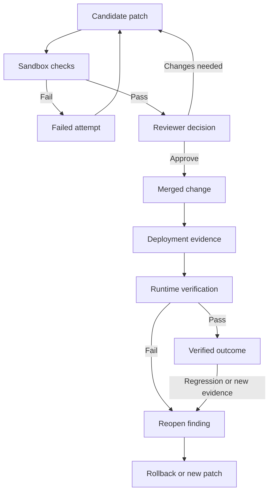

# Enterprise security knowledge and smaller models

**Status:** proposed architecture, with a deliberately limited offline prototype. Product descriptions below are grounded in the linked official sources, reviewed on 2 November 2026. Proposed schemas, workflows and maturity gates are engineering recommendations, not existing integrations or measured results.

## 1. Preserve engineering experience independently of the model

The durable asset should be a record of what the enterprise intended, what it actually deployed, what failed, what changed, and which evidence established the outcome. A ten-year history of these relationships can support architecture reviews, incident analysis, remediation and onboarding even when coding assistants, scanner suppliers and model providers change.

Store original evidence and structured records separately from model summaries. A generated explanation is useful, but it must retain links to its source observations and distinguish facts, hypotheses and reviewer decisions. Rebuilding a search index or changing an embedding model must not destroy history. Model weights should never be the only place where an important business constraint or remediation lesson exists.

Treat Markdown as a versioned view of this knowledge. Generate a small application view, infrastructure view and task-specific context packet from canonical records. Keep the underlying threat-model export, findings, deployment metadata, patch and test evidence available through their original identifiers. Avoid repeatedly loading an entire enterprise knowledge base into an agent prompt.

## 2. Give each component a clear job

| Component | Proposed responsibility | Boundary |
| --- | --- | --- |
| Graphify | Navigate source structure and collect relevant code relationships | A code relationship does not prove an exploit or a deployed resource mapping. |
| Relational records | Preserve identities, ownership, versions, controls, approvals and outcomes | Exact joins require dependable identifiers. |
| Graph relationships | Connect requirements, code, artifacts, resources, findings and fixes | Every edge needs provenance and validity information. |
| Text and vector retrieval | Find relevant passages and previous examples | Similarity is a retrieval signal, not permission or proof. |
| Coding model or specialist SLM | Interpret bounded context and propose changes | Independent checks determine whether a result is acceptable. |
| MindsDB Query Engine | Optional SQL access across enterprise sources and semantic indexes | It does not replace the evidence model or verification workflow. |

[Graphify's official architecture](https://docs.graphify.com/concepts/architecture) describes local code parsing, model-assisted semantic extraction for other inputs, provenance labels and limitations from dynamic dispatch, generated code and stale inputs. Its [README](https://github.com/Graphify-Labs/graphify/blob/v8/README.md) documents the `graphifyy` distribution, `GRAPHIFY_BACKEND=none`, schema/version metadata and scoped CLI queries. Start with the local code-only route and explicitly enable a semantic backend when needed.

[pgvector](https://github.com/pgvector/pgvector) supplies vector similarity search within PostgreSQL, alongside ordinary relational capabilities. The proposed initial stack is PostgreSQL for records and edges, full-text search for exact terminology, and optional pgvector retrieval. Introduce a separate graph database only when measured traversal or scale requirements justify it.

[MindsDB's query-engine documentation](https://mindsdb.github.io/engine/) separates federated SQL, knowledge bases, embedding models, vector storage and optional agents. The [current repository](https://github.com/mindsdb/engine) describes hybrid retrieval. Its [official product explanation](https://mindshub.ai/mindshub-vs-mindsdb) identifies MindsHub as the broader product and the original engine as a community-maintained project. Validate that maintenance and integration fit before making the engine a critical dependency.

## 3. Connect enterprise standards to observed architecture

Create an approved enterprise-architecture pattern catalogue. Each pattern should have an owner, immutable revision, applicability conditions, explicit requirements, permitted exceptions, associated tests and a deprecation policy. Examples could include a public API pattern, an internal event-processing pattern, or handling of restricted customer documents.

Connect versioned OpenSpec artifacts and architecture decisions to that catalogue using stable identifiers. This is a proposed integration contract; it does not assume OpenSpec already supplies every field or control. Pin the exact specification revision used for an assessment. Preserve requirement, scenario and acceptance-test relationships across revisions rather than matching them solely by a mutable title.

A requirement change should generate an impact assessment. It should not silently rewrite every application's history. Record whether an application adopted the new pattern, remains under a time-limited exception, or still awaits assessment. Distinguish intended architecture, declared infrastructure and observed runtime state; disagreement between them is valuable evidence.

Reverse engineering establishes the observed side. Link source symbols to build artifacts, artifact digests to deployment manifests, deployments to cloud resources, and infrastructure addresses to resource identities. Record uncertainty when these links cannot be established. Tags and similar names are candidate matches; they should not override contradictory deployment evidence.

## 4. Record what was true and when it became known

Use two timelines. **Valid time** expresses when a fact applied to the application or environment. **Transaction time** expresses when the knowledge system recorded that fact. This proposed distinction supports questions such as: “What was deployed during the incident?” and “What information did the reviewer have when approving the patch?”

For example, a deployment may have occurred on Monday but its missing manifest may arrive on Wednesday. The deployment's valid time remains Monday. The Wednesday recording time prevents the system from implying that Monday's reviewer already knew it. Corrections should supersede earlier assertions without erasing the original record.

Recommended production fields include:

| Field group | Examples | Purpose |
| --- | --- | --- |
| Scope | `tenant_id`, `app_id`, `environment`, `account_id`, `region` | Keep identities and access boundaries explicit. |
| Identity | `record_id`, `subject_id`, `source_record_id`, `record_type` | Resolve exact entities before semantic search. |
| Versions | `repo_id`, `commit_sha`, `artifact_digest`, `spec_revision`, `pattern_revision` | Bind conclusions to exact inputs. |
| Time | `valid_from`, `valid_to`, `recorded_at`, `superseded_at` | Separate historical reality from knowledge arrival. |
| Evidence | `source_uri`, `content_digest`, `collector_version`, `observed_at` | Reproduce and inspect an assertion. |
| Provenance | `assertion_type`, `confidence`, `reviewer_id`, `supersedes_id` | Separate observation, inference and approval. |
| Applicability | `preconditions`, `invalidation_events`, `expires_at` | Determine whether a conclusion still applies. |
| Governance | `classification`, `access_policy_ref`, `retention_policy_ref`, `training_rights` | Control use, retention and sharing. |

Keep assertions separate from verification results. A hash establishes a content identifier; it does not, by itself, authenticate the producer or verify a signature. A reported signed artifact needs a separate verification event recording the verifier, trust policy, identity, result and verification time.

## 5. Make fixes evidence-backed experiences

A useful remediation record includes the original finding, affected assets, relevant specification, investigation, rejected alternatives, patch, tests, review decision, deployment and later observations. Record failed attempts and rollbacks with the same care as successes. They explain when an apparently attractive fix is inappropriate.

Keep the states distinct:

Merging a PR establishes that a change was merged. It does not establish deployment or vulnerability closure. Record those outcomes separately, including a security issue reopened after a later dependency upgrade. A rollback is a new event linked to the original fix, not a deletion of its successful earlier observations.

For each validation run, retain the exact patch and base revisions, test-suite revision, commands or job definition, runner image, dependencies, environment class, result, logs and evidence digest. Functional tests protect user behaviour; unit tests exercise relevant logic; integration and end-to-end tests check affected interactions. Security tests should test the reported weakness and the intended defence. Select checks according to the change and its risk rather than interpreting any green test run as sufficient.

Local and cloud sandboxes should advertise their fidelity and omissions. A local mock of a cloud service may be useful for application logic but cannot establish that the deployed IAM policy works. Cloud validation needs its own scoped environment, evidence and cleanup record.

## 6. Preserve old lessons without trusting old posture

A historical fix can remain a useful example after its runtime evidence expires. Separate **historical usefulness** from **current applicability**. Retain a decade-old explanation of a design tradeoff while requiring new checks before using that pattern in a different framework, cloud account or regulatory context.

Define invalidation events: an affected code change, deployment replacement, permission modification, dependency update, new advisory, failed control check or revised enterprise pattern. Recompute relevant edges and reopen affected findings when evidence warrants it. Do not reopen every finding after every repository commit; identify the relevant dependency and deployment scope.

Preserve negative evidence and caveats. “Scanner reported no finding” is narrower than “component is secure”; an unexecuted check is unknown. Record scanner coverage, unsupported languages, failed collectors and unavailable accounts. When a source expires, downgrade current confidence instead of silently carrying forward a pass.

Backups, migration tests, restore exercises and retention policies are part of the ten-year design. Retention rules should apply to source evidence and derived copies, including search chunks, exported packets and training datasets. A model migration must preserve the original records and their access restrictions.

## 7. Retrieve a bounded, authorized context packet

The proposed retrieval order is:

1. Authenticate the caller and enforce tenant, application, environment and classification access.
2. Resolve exact identities and requested versions, including deployment-to-commit relationships.
3. Traverse relevant code, resource, requirement and finding edges.
4. Use lexical or vector search for related explanations and previous fixes.
5. Re-rank by applicability, evidence quality and recency; preserve disagreement and uncertainty.
6. Build a task packet with source references, preconditions, constraints and required checks.

Authorization must apply before content enters the model context, including relationship traversal and vector results. A similarity search must not reveal another application's restricted fix simply because its text resembles the query. Cache keys should include scope, input revisions and authorization context; invalidation must follow both source changes and access changes.

Repository text, scanner descriptions and retrieved documents remain untrusted inputs. They may contain apparent instructions. Fixed agent instructions should define how evidence is interpreted, while runtime permissions and deterministic checks constrain available actions. Markdown quoting alone does not solve semantic prompt injection.

## 8. Share knowledge through governed abstractions

Begin with application-level ownership and explicit enterprise access policies. Broader sharing can use reviewed patterns: the failure mechanism, applicability conditions, generic transformation and validation method. Raw proprietary source, customer identifiers, credentials, incident details and sensitive architecture should not flow automatically into another tenant's context or training data.

Make a reusable recipe a separately approved artifact with its own owner and version. Record where it came from, what was removed, which rights permit its use, and where it may be applied. A redacted narrative can still disclose sensitive information; require substantive review when promoting knowledge across organizational boundaries.

Keep permission to retrieve, execute and train separate. Approval to read an incident report does not automatically permit model training or external processing. A withdrawn permission should invalidate cached packets and future dataset exports, with an auditable record of the change.

## 9. Reduce model dependence through measured routing

An SLM remains a language model. The practical objective is to perform more work with reliable parsing, rules, retrieval and narrow specialist models, while keeping a stronger model available for difficult tasks.

Start by making ingestion, identity matching, freshness evaluation, policy gates and rendering deterministic. Convert repeated, well-understood fixes into recipes with explicit preconditions. Evaluate a small model for bounded tasks such as classifying findings into known families, selecting candidate evidence, ranking recipes or proposing a constrained patch. Do not begin by training a model to reproduce an entire security architect's judgement.

Use a provider-independent job contract: task type, authorized context references, allowed operations, output schema, acceptance checks and escalation conditions. Route according to measured capability on that task and the current evidence quality. Missing context, novel vulnerability classes, conflicting sources and high-impact changes should trigger additional analysis or review.

Training data should include failed patches, reviewer corrections, rejected hypotheses and rollbacks. Protect evaluation sets by separating repositories, time windows and related patch families; neighboring commits and duplicated recipes can otherwise leak answers. Compare deterministic recipes, retrieval with the current coding model, retrieval with a small model, and fine-tuning only when earlier baselines justify it.

Measure verified closure, regressions, newly introduced vulnerabilities, reviewer rejection, rollback, abstention quality and total cost per accepted outcome. Include retrieval, inference, infrastructure and human review costs. Do not promise a fixed token saving or model accuracy before measuring representative enterprise work.

## 10. Advance through observable maturity gates

| Gate | Evidence required before expansion |
| --- | --- |
| One-app vertical slice | Correct source-to-resource ownership, fresh evidence and a reproducible reviewed fix. |
| Multiple repositories | Reliable deployment/artifact mapping, access isolation and versioned pattern applicability. |
| Durable enterprise memory | Event history, valid/transaction-time queries, restore tests and source/permission invalidation. |
| Reusable recipes | Repeated success on held-out applications with explicit preconditions and rollback behaviour. |
| Specialist small models | Comparable safety and acceptable outcomes on withheld work, plus effective escalation. |
| Broader automation | Stable operational evidence, bounded permissions and independent acceptance gates. |

These are acceptance criteria, not a delivery schedule or savings forecast. Passing a gate for one vulnerability family does not establish readiness for every application or cloud control.

## 11. What the offline prototype actually demonstrates

`context_compiler.py` validates a supplied canonical bundle and writes generated Markdown, finding packets and a SQLite snapshot. It checks scope, full Git SHA format and linkage, declared ownership, timestamps and evidence freshness. A reported verified fix must reference supplied evidence for the exact patch and repository. Querying rechecks freshness at the requested time, defaulting to current UTC.

It does not call AWS, Graphify, scanners, Threat Composer or coding models; verify signatures; execute tests; authenticate upstream producers; or deploy a fix. The demo data is synthetic. Exact scope filters are not a user-authentication system. Its database replaces the current scope snapshot and therefore does not implement the durable event history or two-timeline design above. Historic time travel is explicitly unsupported.

The output assumes a trusted local process without hostile concurrent directory mutations. Generated text escapes Markdown structure, but remains untrusted evidence for downstream agents. These limits keep the prototype useful as a small context-generation and validation component without presenting it as the finished enterprise security platform.
